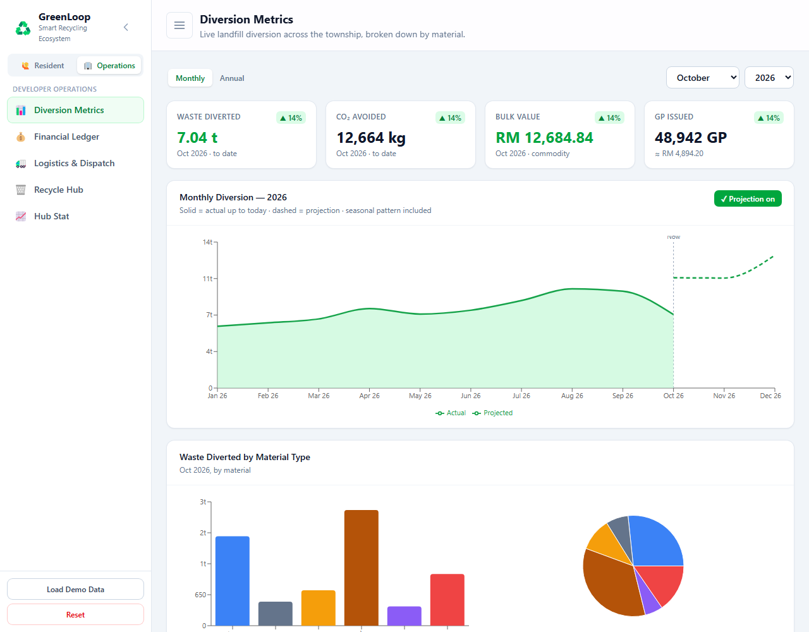
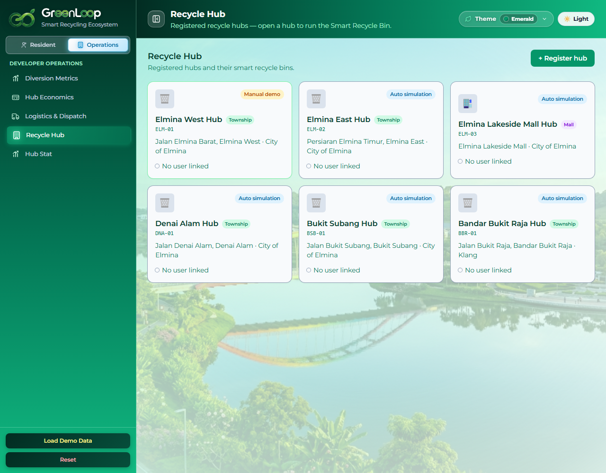
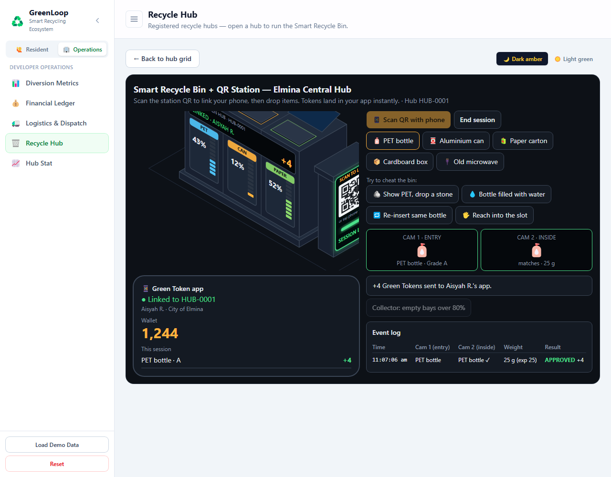
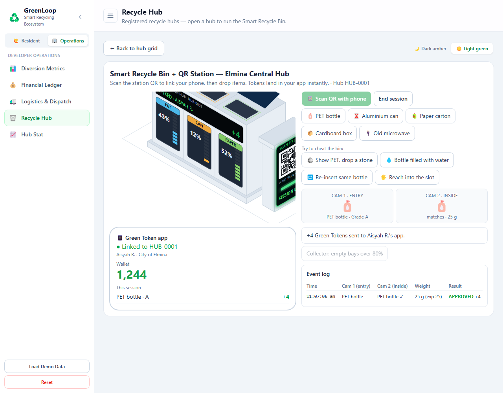

# ♻️ GreenLoop — Smart Recycling Ecosystem

**Level Up Recycle:** turn everyday recycling in a township into a self-funding,
gamified, AI-assisted loop that benefits residents, mall tenants and the property
developer all at once.

**🔗 Live demo:** https://greenloop-tan.vercel.app

Everything runs client-side, so there is no backend, no API keys and no sign-up.
Open the link, click **Load Demo Data**, and explore both sides of the ecosystem.

---

## 🎯 Why GreenLoop

Recycling at township scale keeps stalling on the same three problems:

1. **Residents have no real reason to bother.** Separating and dropping off waste
   is effort with no immediate, tangible reward, so participation stays low.
2. **Recycling is treated as a cost centre.** Developers and councils see bins,
   trucks and operators as pure expense, so programmes get cut when budgets tighten.
3. **Collection is blind and wasteful.** Trucks run fixed routes to half-empty
   bins, burning fuel and labour whether a bin needs emptying or not.

GreenLoop closes the loop so recycling *levels up* from a chore into an economy.
Residents and mall tenants earn **Green Points (GP)** by material and weight, then
spend GP like cash at township outlets or offset their monthly maintenance /
service charge. The developer funds those rewards from money the township
**already saves**: avoided landfill haulage, bulk material sales and carbon value.
An **AI dispatch layer** sends trucks only to bins that are actually full. The
result is a recycling programme that **pays for itself and keeps running** instead
of a one-off campaign.

The prototype is based on **real Sime Darby Property** developments in the Klang
Valley: **City of Elmina** (Elmina West/East, Denai Alam, Bukit Subang),
**Elmina Lakeside Mall**, and **Bandar Bukit Raja**. Using actual townships,
malls and locations means the demo maps directly onto an existing Sime Darby
Property community rather than a made-up map.

---

## 💡 What makes it different

| Most recycling apps | GreenLoop |
| --- | --- |
| Reward points with no funding model | Rewards funded by avoided haulage, material sales and carbon value, a proven surplus rather than a subsidy |
| "Trust me, it's recyclable" | An **AI vision check** verifies the item before it is accepted |
| Fixed truck routes | **Live AI dispatch** collects only full bins, with no double-booking and real road routing |
| One user type | **Residents and mall tenants** in one engine, with role-appropriate rewards |
| Pretty numbers that only go up | Data grounded in Malaysian recycling economics, with seasonality and no fabricated future data |

---

## ✨ Features

### For Residents & Mall Tenants
- **🔗 Scan Hub QR to pair:** start a session at a specific Smart Hub (like
  scanning the QR sticker on arrival); drop-offs are attributed to that hub.
- **🤖 AI recyclability check** with three scan modes:
  - **Example Photo:** generated item photos analysed with a scan-line and detection box.
  - **Upload Image:** a real photo classified in-browser with TensorFlow.js COCO-SSD.
  - **Live Camera:** runs COCO-SSD on the webcam, lists every detected object with a
    recyclable / not-recyclable verdict, and tallies recyclables into the drop-off.
- **🪙 Earn Green Points** by material and weight (the same model reverse vending
  machines and Malaysia's KITARecycle use); the GP/kg table is shown in-app.
- **🎟️ Redeem Vouchers:** spend GP like cash at Elmina Lakeside Mall, JUMPA and
  KL East Mall tenants; each voucher has a QR code, barcode, code and "Mark as Used".
- **🏠 Offset your fee:** apply GP to the monthly maintenance fee (residence) or
  mall service charge (tenant) with a slider or typed amount.
- **🧑 Profile & Activity:** editable profile and a full history of drop-offs,
  redemptions and offsets, with independent balances per persona.

### For Developer Operations
- **📊 Diversion Metrics:** landfill diversion by material, Monthly/Annual views, a
  Malaysian seasonal pattern (Hari Raya spike, monsoon dip), a hub contribution
  ranking, and an optional dashed projection that is always kept visually separate
  from actual data. The future is left empty; the app never invents data past today.
- **💰 Hub Economics:** the ROI and business-case story (an indicative model, not
  audited financials). Avoided haulage, commodity sales and carbon value, minus
  operating cost and only the GP residents **actually redeem** (unredeemed GP is
  shown as an outstanding liability). Net surplus, ROI %, CapEx
  payback, and a 3, 12 or 24 month forecast with realistic ups and downs.
- **🚛 Logistics & Dispatch:** a live simulation. A Play/Pause clock (0.5× to 10×)
  advances the day, bins fill in real time, and at **80%** the AI auto-schedules a
  pickup (honouring a 15:00 cutoff then next-morning rule). A 2-lorry fleet is
  assigned with no double-booking, and trucks drive real roads (OSRM) on a live map
  with a flight-board schedule.
- **🗑️ Recycle Hub network:** a grid of registered Smart Hubs (Manual demo / Auto
  simulation badges, Township / Mall type) with a **Register hub** form. Open any
  hub to run the Smart Recycle Bin + QR Station, a two-camera verification demo
  (entry cam vs inside cam) that catches cheating (stones, water-filled bottles,
  re-inserts), awards tokens, and logs every event. Dark-amber and light-green themes.
- **📈 Hub Stat:** per-hub station performance by Day / Month / Year, material
  breakdown and hub ranking. One source of truth: every screen (Logistics, Recycle
  Hub, Hub Stat, resident QR grid) reads the same 6 hubs, so counts and names never drift.

### Built for the real world
- **📱 Mobile-ready:** works in a phone browser. The sidebar becomes an off-canvas
  drawer, tables scroll, charts and the map scale, and there is no horizontal overflow.
- **🔢 Tunable economics:** every figure (weights, GP rates, prices, fill rates,
  seasonality, fleet, operating hours) lives in `src/data/catalog.js` and can be
  changed live during a demo.
- **💾 Persistent:** state is saved to `localStorage`, so a refresh keeps your progress.

---

## 🎬 Demo walkthrough

1. Open the **[live demo](https://greenloop-tan.vercel.app)** and click **Load Demo Data**.
2. **Resident side, Scan & Drop-off:** pair with a hub via QR, scan an item (try
   **Live Camera** or **Upload Image** for the real AI), then drop it to earn GP.
3. **Offset Fee / Redeem Vouchers:** spend GP against the maintenance fee, or redeem
   a voucher and open its QR/barcode.
4. Switch to **Developer Operations** (top of the sidebar):
   - **Diversion Metrics:** toggle **Show projection** and switch Monthly/Annual;
     note the future stays empty and the pattern has seasonal ups and downs.
   - **Hub Economics:** see how the hub turns a surplus and pays back its setup.
   - **Logistics & Dispatch:** press **Play**, speed up to 10×, and watch bins fill
     and trucks auto-dispatch along real roads.
   - **Recycle Hub:** open **Elmina West Hub** and try to cheat the Smart Bin.
5. **Reset** clears everything.

### Screenshots

| | |
| --- | --- |
| Resident, Scan Hub QR |  |
| Resident, Scan & Drop-off |  |
| Resident, Redeem Vouchers |  |
| Ops, Diversion Metrics |  |
| Ops, Diversion (projection on) |  |
| Ops, Hub Stat |  |
| Ops, Hub Economics |  |
| Ops, Logistics & Dispatch |  |
| Ops, Recycle Hub network |  |
| Ops, Smart Bin (dark) |  |
| Ops, Smart Bin (light) |  |

---

## 🚀 Run it locally

**Prerequisites:** [Node.js](https://nodejs.org/) 18+ and npm.

```bash
# 1. Install dependencies
npm install

# 2. Start the dev server
npm run dev
```

Then open **http://localhost:5173** and click **Load Demo Data**.

> 💡 The **Live Camera** AI check needs a secure context (HTTPS or `localhost`).
> It works on the hosted demo and on `localhost`, but not on a plain-HTTP LAN address.

### Other commands

```bash
npm run build     # production build into dist/
npm run preview   # preview the production build locally
npm test          # run the Vitest unit tests
```

---

## 🏙️ Piloting with Sime Darby Property

GreenLoop is designed to start small and prove itself before any township-wide
rollout.

**Pilot at one location first.** Deploy a single Smart Hub at one precinct, for
example **Elmina West** in the City of Elmina, or one retail bin-bank at **Elmina
Lakeside Mall**. Run it for one quarter, measure real diversion, participation and
cost, and compare the actual numbers against this model's assumptions.

**What this prototype demonstrates vs. what it simulates.** The flows, UX,
dispatch logic and economic model are real and interactive, but the figures are an
**indicative model**, not live data. Before a real deployment the following need to
be integrated and validated:

- **Hardware** — real reverse-vending / smart-bin units and camera CV in place of
  the simulated scan and bin sensors.
- **Avoided-cost assumption** — confirm the **RM 230/tonne** avoided haulage figure
  against Sime Darby Property's actual waste-contractor tipping and haulage rates.
- **Commodity prices** — validate the per-material buyback rates against current
  recycler contracts (prices move with the market).
- **Reward redemption** — integrate Green Points with mall-tenant POS / the
  township app, and confirm the real redemption rate (modelled at 65%).
- **Resident identity** — link accounts to township residency / tenancy, with
  data-privacy (PDPA) handling for personal and activity data.
- **Operations** — connect live bin-fill telemetry and the real collection fleet to
  replace the simulated dispatch clock.

Once validated at one hub, the same model scales precinct by precinct — the return
compounds as participation grows.

## 🧱 How it works (under the hood)

**Green Points** are granted by material and weight: each material has a GP-per-kg
rate in `MATERIAL_RATES` (`src/data/catalog.js`) and a drop-off earns
`round(gpPerKg × weight)`. The resident reward per kg is held to roughly a third of
the hub's total benefit per kg, so rewarding residents never loses money. Drop-off
quantities are capped realistically: a household submits tens of items, a mall
tenant submits commercial bulk.

**The ROI model** (`src/data/catalog.js` → `ECONOMICS`, `src/lib/finance.js`)
combines avoided landfill/haulage (the biggest, most defensible driver), bulk
commodity sales and carbon/ESG value, minus operating cost and redeemed GP. The
surplus pays back the one-time setup (`hubCapex`) and compounds as engagement grows.

**Time-series integrity:** past months carry a Malaysian seasonal pattern plus
organic variation; the current month is partial (to date); future periods are empty
unless you explicitly turn projection on. The app never fabricates data beyond today.

## 🛠️ Tech stack

- **React 18 + Vite 5** for UI and build tooling
- **Tailwind CSS v4** (`@tailwindcss/vite`) for styling
- **Recharts** for charts and forecasts
- **React Leaflet + OpenStreetMap** for the dispatch map
- **OSRM** for real road routing
- **TensorFlow.js COCO-SSD** for in-browser object detection in the AI scan
- **qrcode.react** for voucher QR codes
- **Vitest** for unit tests (engine and store reducer)

State lives in a React context and reducer, persisted to `localStorage`.

## ☁️ Deploy

Hosted on **Vercel** (auto-detected Vite preset). Every push to `main`
auto-deploys. To deploy your own fork: import the repo at
[vercel.com](https://vercel.com), keep the auto-detected settings, and deploy.
