# GreenLoop — Smart Recycling Ecosystem (Prototype)

A dual-sided web simulation for township recycling. **Residents and mall tenants**
recycle at a Smart Hub to earn **Green Points (GP)**; the **property developer**
earns avoided-haulage savings, bulk commodity revenue and carbon value that fund
the points economy and cut logistics cost with AI fleet dispatch. All data is
simulated client-side — no backend, no API keys required.

**Live demo:** https://greenloop-tan.vercel.app

---

## Screenshots

### Login — User / Tenant / Operation (one-click demo accounts)
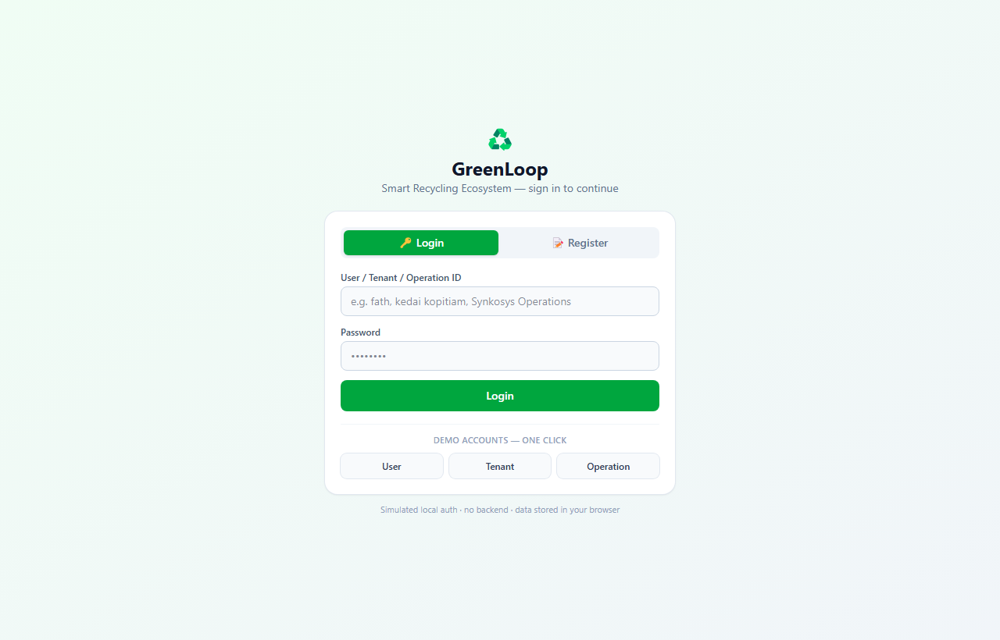

### Resident — Profile
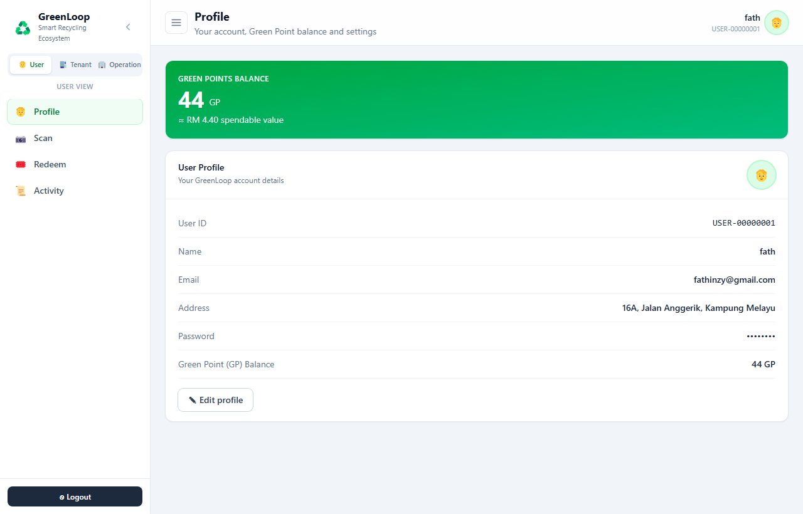

### Resident — Scan Hub QR to start a session
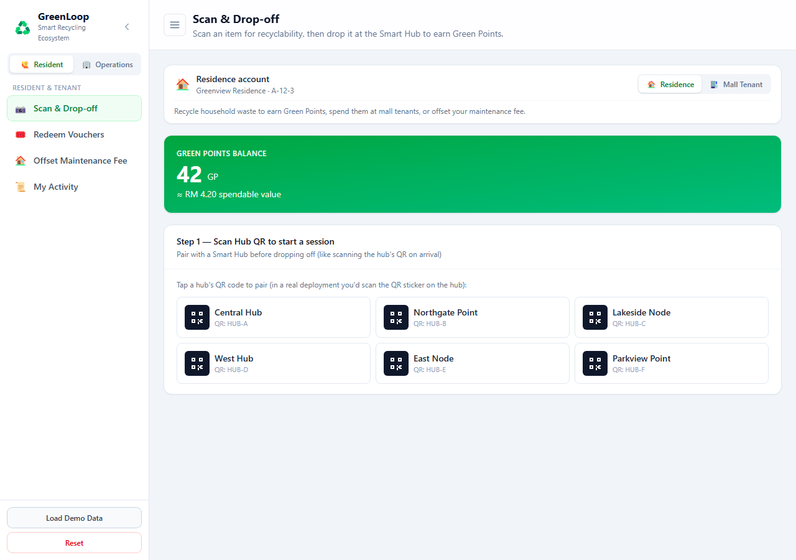

### Resident — Scan & Drop-off (AI recyclability check → earn GP)
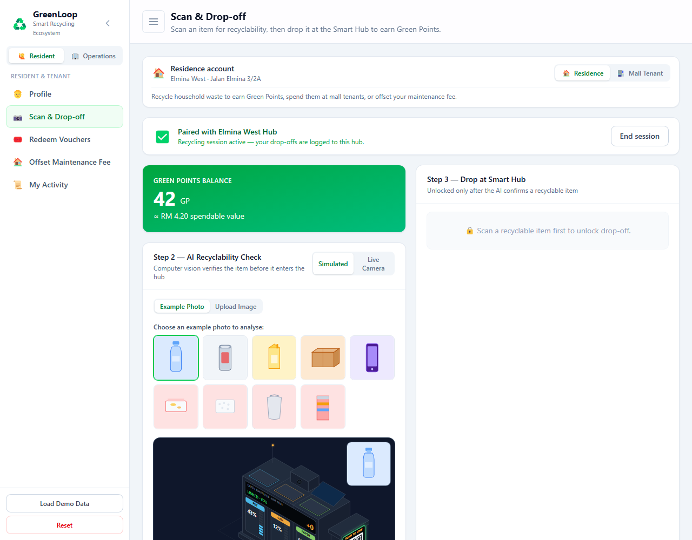

### Resident — Redeem Vouchers (QR / barcode / code)
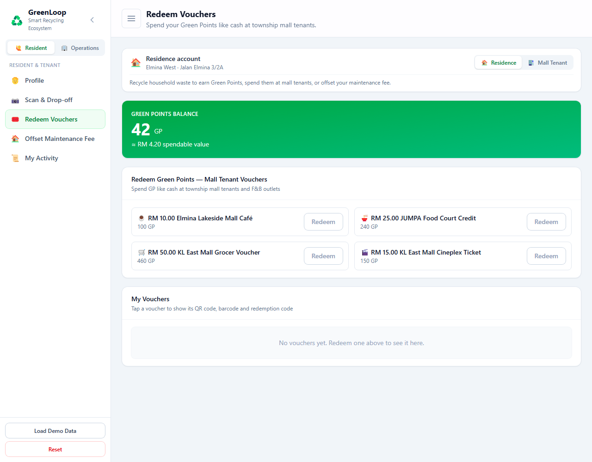

### Operations — Recycle Hub grid
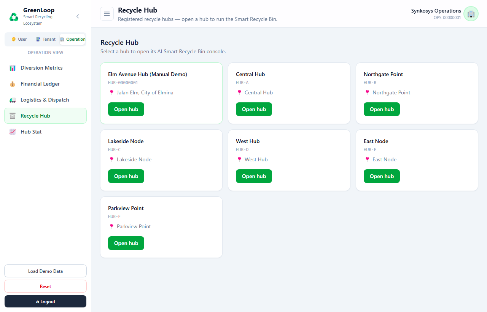

### Operations — AI Smart Recycle Bin console
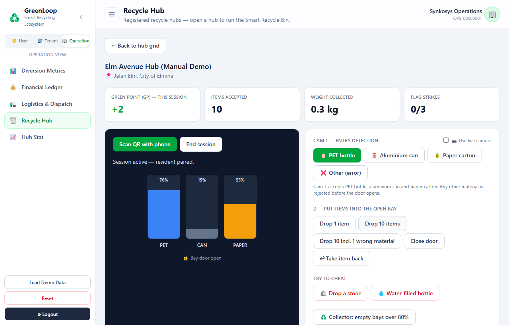

### Operations — Hub Stat (performance, materials, ranking)
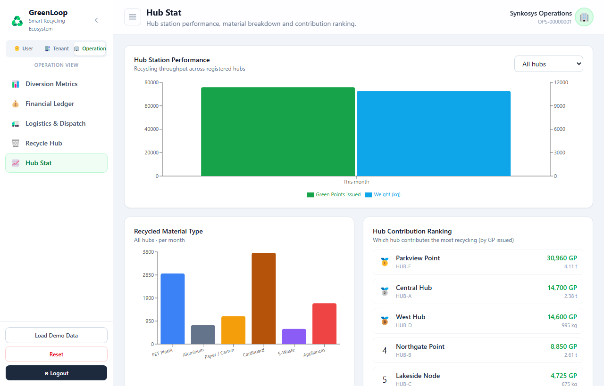

### Operations — Diversion Metrics (actual vs projected, seasonal)
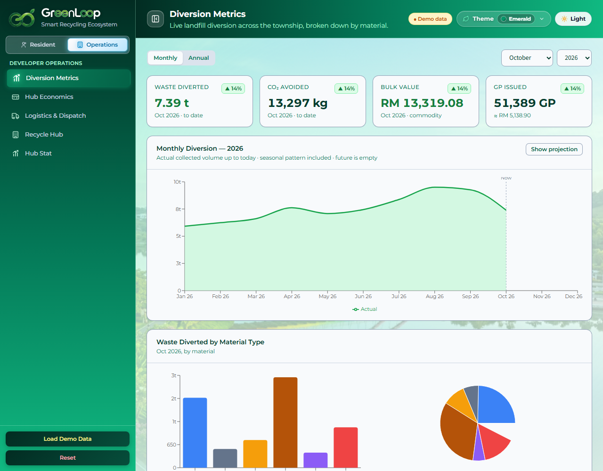

### Operations — Financial Ledger (ROI, payback & forecast)
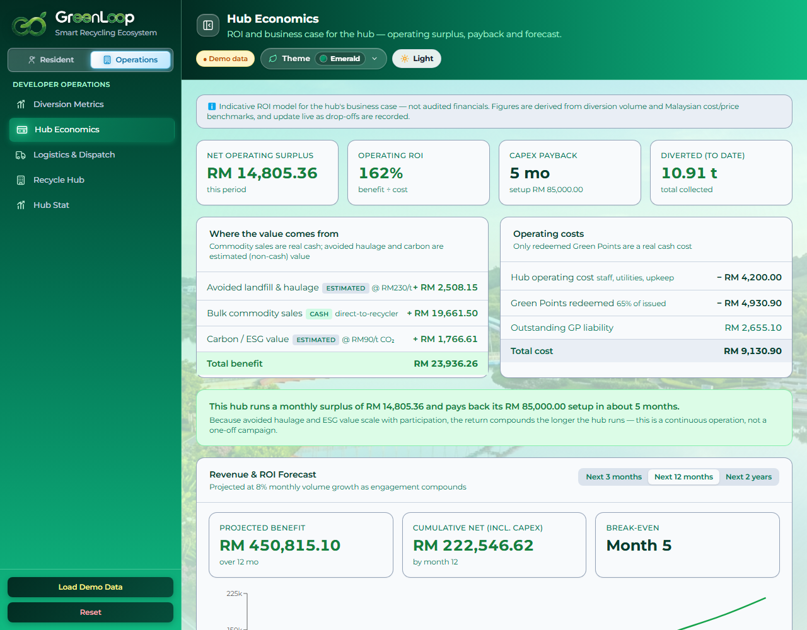

### Operations — Logistics & Dispatch (live clock, auto dispatch, road routing)
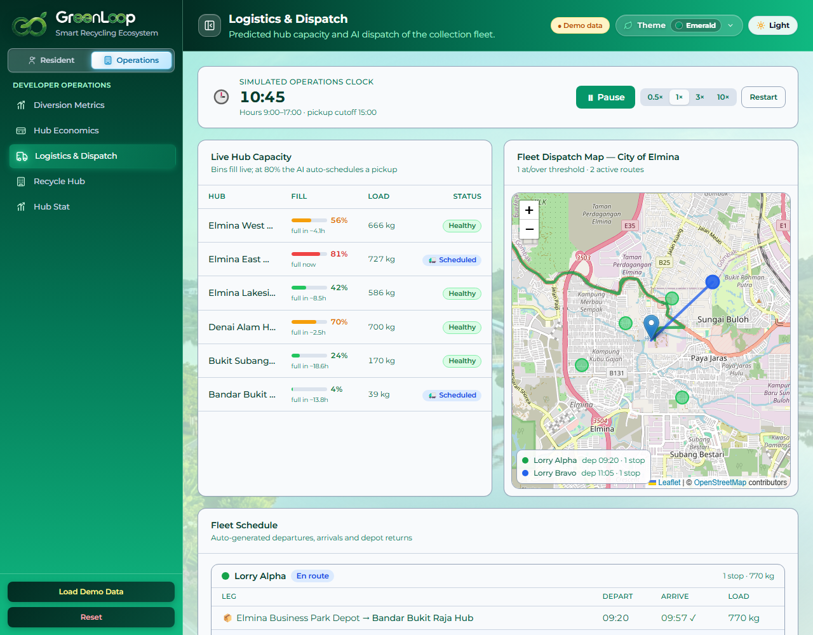

---

## Run it

```bash
cd greenloop
npm install
npm run dev     # http://localhost:5173
```

Other commands:

```bash
npm run build   # production build into dist/
npm test        # run the Vitest unit tests
```

## Login & roles

The app opens on a **login screen** (simulated local auth — no backend; accounts
live in `localStorage`). Sign in as **User**, **Tenant**, or **Operation**, or
use the one-click demo accounts. Register creates a new local account. Demo
credentials:

- User — `fath` / `greenloop`
- Mall Tenant — `kedai kopitiam` / `greenloop`
- Operation — `Synkosys Operations` / `synkosys123`

The logged-in role determines the view. A **role toggle** in the sidebar also
lets you jump between roles for a quick demo. Each role has its own menu:

- **User View** — Profile · Scan · Redeem · Activity
- **Tenant View** — Profile · Scan · Offset Maintenance Fee · Activity *(no vouchers — a tenant is a business)*
- **Operation View** — Diversion Metrics · Financial Ledger · Logistics & Dispatch · **Recycle Hub** · **Hub Stat**

Every role has a **Profile** page (avatar, GP balance, ID/name/email/address,
Edit profile). The header shows the signed-in identity, with **Logout** in the
sidebar.

## Recycle Hub — AI Smart Recycle Bin (Operations)

Each hub runs an **AI Smart Recycle Bin** that handles common items, with a human
operator on site for the rest. The **Recycle Hub** page lists registered hubs;
opening one launches an operator console:

- **Cam 1 — entry detection** accepts PET / aluminium / paper and rejects
  anything else before the door opens.
- **Put items into the bay** (drop 1 / 10 / 10-with-1-contaminant); accepted
  items credit Green Points and feed township metrics.
- **Cam 2 — inside verification + weight audit** catches contaminants and cheats
  (drop a stone, a water-filled bottle) → **flag strikes** (bay locks at 3).
- Live **bay fill levels**, a **Collector** that empties bays over 80%, and an
  **event log** (Cam 1 / Cam 2 / weight / result).

**Hub Stat** shows hub station performance (GP + weight), recycled material type,
and the hub contribution ranking.

## How Green Points are granted

Points follow the model real schemes use (reverse vending machines, Malaysia's
KITARecycle): **by material and weight**. Each material has a GP-per-kg rate in
`src/data/catalog.js` (`MATERIAL_RATES`), and a drop-off earns
`round(gpPerKg × weight)`. Bulk sale prices (`bulkRmPerKg`) are tuned to
indicative Malaysian buyback ranges — aluminium and e-waste highest, then PET,
then paper/cardboard. The Scan & Drop-off page shows the GP/kg table so the
logic is transparent. The resident reward per kg is kept to roughly a third of
the hub's total benefit per kg, so rewarding residents never loses money.

Drop-off quantities are capped realistically per account type: a **residence**
is household-scale (tens of items per drop-off); a **mall tenant** can submit
commercial bulk (hundreds).

## How the hub makes money (ROI model)

The developer return is **not** scrap sales alone. The economics in
`src/data/catalog.js` (`ECONOMICS`) and `src/lib/finance.js` combine:

- **Avoided landfill & haulage** — the township already pays a contractor to
  haul and tip waste, so every kg diverted is a cost avoided (the biggest and
  most defensible driver).
- **Bulk commodity sales** — pre-sorted material sold direct to recyclers.
- **Carbon / ESG value** — value of avoided CO₂ toward Net Zero targets.

minus **hub operating cost** and only the **Green Points residents actually
redeem** (unredeemed GP is shown separately as an outstanding liability). The
result is a monthly operating surplus that pays back the one-time setup
(`hubCapex`) in a few months and compounds as engagement grows — a continuous
operation, not a one-off campaign. The Financial Ledger forecasts this over the
next 3 months, 12 months, or 2 years.

## Demo flow (for judges)

1. Click **Load Demo Data** to populate township figures and both resident accounts.
2. **Scan & Drop-off** (resident):
   - **Step 1 — Scan Hub QR** to start a recycling session (tap a hub's QR to
     pair). Drop-offs are attributed to the paired hub, feeding its live
     capacity in the dispatch sim. End the session any time.
   - **Simulated** mode has two sources: **Example Photo** (generated inline-SVG
     photos analysed with a scan line + detection box) and **Upload Image**
     (a real photo classified in-browser with TensorFlow.js COCO-SSD).
   - **Live Camera** mode runs COCO-SSD on the webcam, **lists every detected
     object** with a recyclable/not verdict, and tallies recyclable items into
     drop-off quantities. Needs camera permission; falls back gracefully.
     (Works on the HTTPS demo URL; blocked on plain-HTTP addresses.)
   - **Drop at Smart Hub** to earn GP; drop-offs also feed the township metrics.
3. **Offset Fee** — apply GP with a **slider or typed value** (Half / Max
   shortcuts); the progress bar fills. Labelled "maintenance fee" for a
   residence, "mall service charge" for a tenant.
4. **Redeem Vouchers** (residence only) — spend GP like cash; redeemed vouchers
   appear under **My Vouchers**, each with a **QR code, barcode and code** and a
   **Mark as Used** action.
5. **My Activity** — the active account's drop-offs, redemptions and offsets.
6. **Diversion Metrics** (operations) — pick **Monthly/Annual** and a **month/year**;
   the chart shows **actual (solid) vs projected (dashed)** diversion with a
   Malaysian **seasonal pattern** (Hari Raya spike, monsoon dip), plus trend arrows.
   Includes a **Hub Contribution Ranking** showing which hubs divert the most.
7. **Financial Ledger** — benefit breakdown, operating surplus, ROI %, CapEx
   payback and a revenue/ROI forecast.
8. **Logistics & Dispatch** — a **live simulation**: a clock (Play/Pause, speed
   0.5×–10×) advances the day; bins fill in real time; at 80% the AI
   **auto-schedules** a pickup (respecting the 15:00 cutoff → next-morning rule).
   A **2-lorry fleet** (Alpha/Bravo) is assigned without double-booking;
   trucks **move along real roads** (OSRM, straight-line fallback) with a
   flight-board schedule of departs/arrives/returns.
9. **Reset** clears everything. State persists across refresh via `localStorage`.

## Concept pillars

- **Hybrid Smart Hub** — AI stream (PET, aluminium, paper) + human stream
  (cardboard, e-waste, appliances), gated by an AI recyclability check.
- **Gamified incentives** — Green Points spendable at township outlets or
  against monthly fees.
- **Zero-cost setup** — avoided haulage + material sales + carbon value fund the
  hub, app and operators.
- **Predictive operations** — forecast hub capacity and dispatch the fleet only
  where it's needed.

## Stack

React 18 + Vite 5, Tailwind CSS v4 (`@tailwindcss/vite`), Recharts for charts,
React Leaflet + OpenStreetMap for the map, OSRM for road routing, TensorFlow.js
COCO-SSD for live/upload vision, `qrcode.react` for voucher QR codes. Shared
state lives in a React context + reducer persisted to `localStorage`.

All figures (weights, GP values, RM prices, hub fill rates, seasonality, fleet,
operating hours) live in `src/data/catalog.js` so they can be tuned live.

## Deploy

Hosted on **Vercel** (Vite preset, config in `vercel.json`). Every push to
`main` auto-deploys. To deploy your own: import the repo at vercel.com, keep the
auto-detected Vite settings, and deploy.
